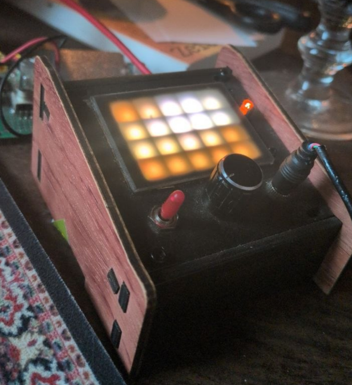
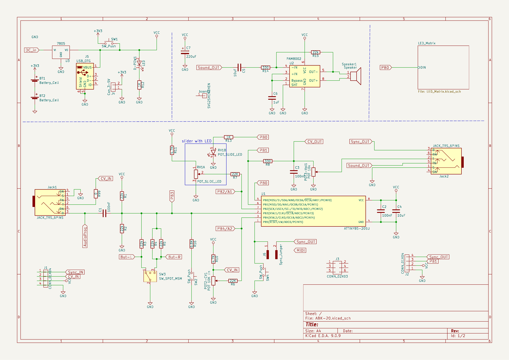
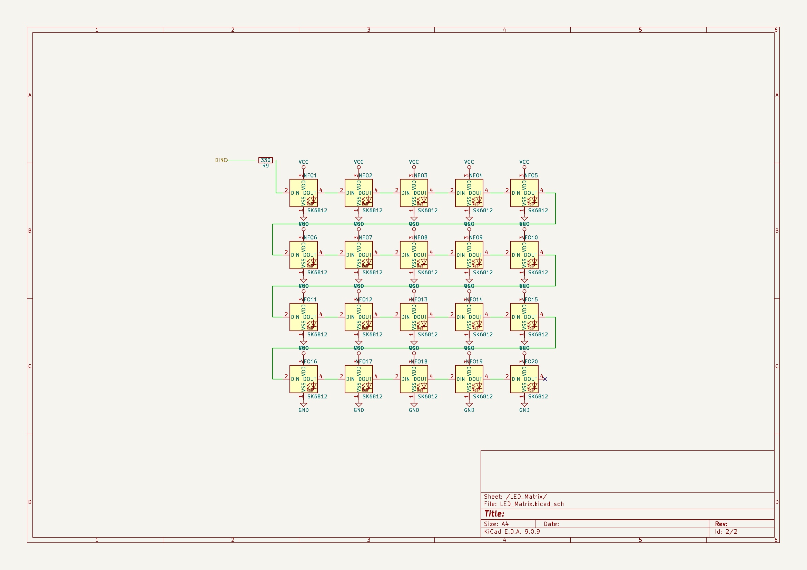
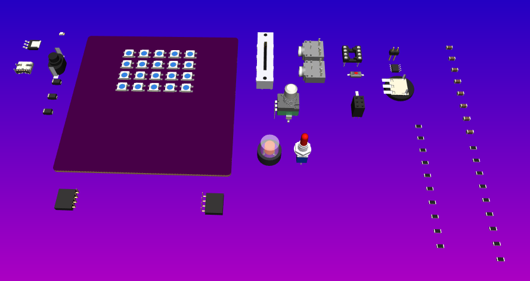

# ABK-20

**8-Bit Algorithmic Audio Synthesizer with 5×4 NeoPixel Matrix Display**

[](https://www.kicad.org/)
[](https://www.microchip.com/en-us/product/attiny85)
[](https://www.oshwa.org/)

<p align="center">
  
</p>

The **ABK-20** is a modernized desktop hardware console redesign of the legendary **8Bit Mixtape**. Powered by a Microchip ATtiny85 running an 8-bit algorithmic sound engine (bytebeats, wavetable, granular, and punk console synths), it features an illuminated **20-LED (5×4) visual display screen**, tactile physical controls, and instant sound sketch loading via the **AudioBoot** bootloader.

---

## Hardware Highlights

* **Microcontroller**: Microchip ATtiny85 running at 16 MHz (Internal PLL).
* **Visual Display**: **20x WS2812B / SK6812 RGB NeoPixels** arranged in a 5-column × 4-row matrix for expressive animations, meters, and UI feedback.
* **Illuminated Slide Fader**: Bourns PTL20 20mm slide potentiometer with an integrated lever LED tied to the status/data line (`PB0`).
* **Tactile Controls**:
  * **Rotary Potentiometer**: 10kΩ linear potentiometer (`POT2-CV1` on `PB4`) for parameter tweaking and modulation.
  * **3-Way Navigation Switch**: Center-OFF toggle switch (`SW_SPDT_MSM` / `SW3`) on `PB3` for menu navigation and mode selection.
  * **Tactile User Button**: Push button (`SW2`) on the `PB3` resistor ladder.
  * **Hardware Reset Button**: Dedicated tactile push button (`SW4`) pulling `PB5` (Reset) to ground.
* **Audio Circuit**:
  * High-speed 8-bit PWM audio synthesized via Timer1 64 MHz PLL.
  * On-board PAM8002 audio amplifier optimized for unity gain ($R_{14} = 22\text{k}\Omega$, $C_5 = 1\mu\text{F}$, $C_8 = 100\text{nF}$) to prevent clipping and preserve deep sub-bass bytebeats through the internal speaker.
  * 3.5mm stereo output jack (switchable line-out / headphones with volume control).
* **AudioBoot Programming**: Upload new sound sketches directly through an audio cable or web browser—no external programmer or USB serial driver required.
* **Power Circuit**:
  * **USB-C 5V Input**: Modern 6-pin USB-C receptacle (`J5`) with dual 5.1kΩ pull-down resistors (`R17`, `R18` on CC1/CC2) for universal compatibility with USB-PD smart chargers and MacBook Type-C ports.
  * **Diode OR-ing Protection**: Automatic seamless power switching via Schottky diodes (`SS14`) across USB-C (5V), 7805 DC In (7–12V), and 3x AAA Battery input with reverse-charge protection.
  * **Master Power Switch**: Latching push switch (`SW1`) with power status LED (`D-POW1`). Cycling `SW1` provides the exact power-cycle timing required to activate AudioBoot sketch loading.

---

## Schematic

The ABK-20 schematic is organized into a modular **KiCad 9 hierarchical architecture**:

### Page 1: Main Architecture & Sound Engine
Controls, ATtiny85 microcontroller, audio filtering, power regulation, and hierarchical sub-sheet block.

<p align="center">
  
</p>

### Page 2: 5×4 NeoPixel Display Matrix
Dedicated hierarchical sub-sheet (`hardware/LED_Matrix.kicad_sch`) with the raster-scan daisy-chained 20-LED array.

<p align="center">
  
</p>

📄 **[Download Complete Multi-Page Schematic PDF (A4)](docs/ABK-20_schematic.pdf)**

---

## PCB Layout & 3D Model View

The 90×90 mm rounded-corner desktop PCB design features the centered 5×4 NeoPixel display matrix (using the 8.92 mm × 7.96 mm pixel grid with single-sided front-copper snake routing), surrounded by tactile controls, Bourns slide fader, audio jacks, and power stages:

<p align="center">
  
</p>

---

## ATtiny85 Pin Mapping

| Pin | Physical | Port | Macro | Function / Description |
| :---: | :---: | :---: | :---: | :--- |
| **PB0** | Pin 5 | `PB0` | `NEOPIXELPIN` | 800 kHz data stream to 5×4 NeoPixel Matrix (via R9 330Ω) & Fader Lever LED (`RV1B`) |
| **PB1** | Pin 6 | `PB1` | `SPEAKERPIN` | High-speed PWM audio output (Timer1 64 MHz PLL) to Volume Pot & PAM8002 amp |
| **PB2** | Pin 7 | `PB2` | `POTI_LEFT` | Slide Potentiometer (`RV1A`) analog control input (ADC1) |
| **PB3** | Pin 2 | `PB3` | `BUTTON_PIN` | AudioBoot audio input (AC-coupled 100nF) & multi-state button resistor ladder (ADC3) |
| **PB4** | Pin 3 | `PB4` | `POTI_RIGHT` | 10kΩ Rotary Potentiometer (`POT2-CV1`) analog control input (ADC2) |
| **PB5** | Pin 1 | `PB5` | `RESET_PIN` | Hardware Reset button (`SW4`) & Sync jumper (`J6`). *(Can be converted to MIDI IN with `RSTDISBL`)* |

---

## Firmware & Web Flasher

The ABK-20 is fully compatible with the sound sketches and web player in:
* **[8Bit-Vintage Firmware Repository](https://github.com/8BitMixtape/8Bit-Vintage)**
* **[Online Web Audio Player & Flasher](https://8bitmixtape.github.io/8Bit-Vintage/)**

---

## Repository Structure

```
ABK-20/
├── hardware/
│   ├── ABK-20.kicad_pro              # KiCad 9 Project file
│   ├── ABK-20.kicad_sch              # Main hierarchical schematic (Page 1)
│   ├── LED_Matrix.kicad_sch          # 5x4 NeoPixel matrix sub-sheet (Page 2)
│   ├── ABK-20.kicad_pcb              # PCB board layout
│   ├── mixtape_schematics.kicad_sym  # Project symbol library (PTL20 fader, etc.)
│   └── 8Bitmixtape_reworked.pretty/  # Project footprints (Bourns PTL20, SK6812, etc.)
├── docs/
│   ├── ABK-20_schematic.pdf          # Multi-page A4 schematic export
│   ├── HARDWARE_NOTES.md             # Hardware architecture and design notes
│   ├── DESIGN_VARIANTS_GUIDE.md      # Guide for creating custom layouts & variants
│   └── img/
│       ├── ABK_prototype_randen.png  # Prototype console photo
│       ├── schematic_page-1.png      # High-res schematic Page 1 render
│       ├── schematic_page-2.png      # High-res schematic Page 2 render
│       └── ABK-20_3D_layout.png      # 3D PCB layout and component staging view
└── production/                       # Fabrication deliverables (Gerbers, BOM)
```

---

## License

Open Source Hardware (OSHW). See [LICENSE](LICENSE) for details.
