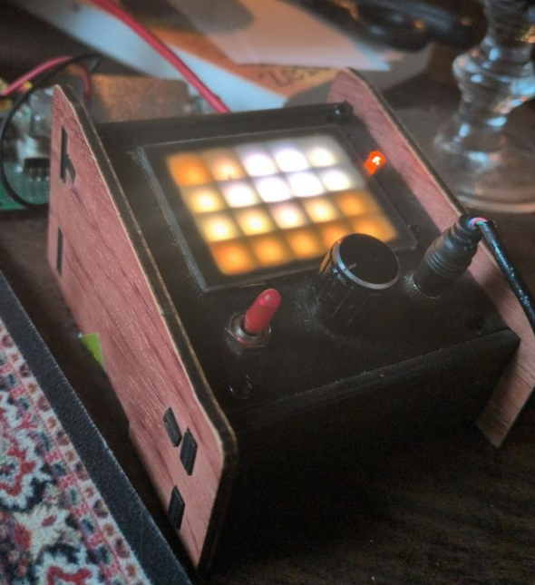
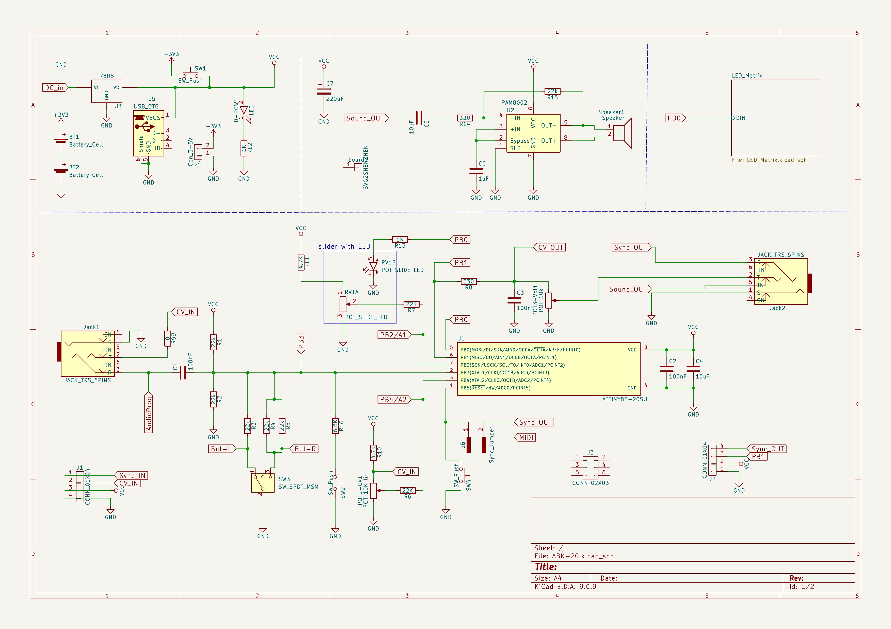
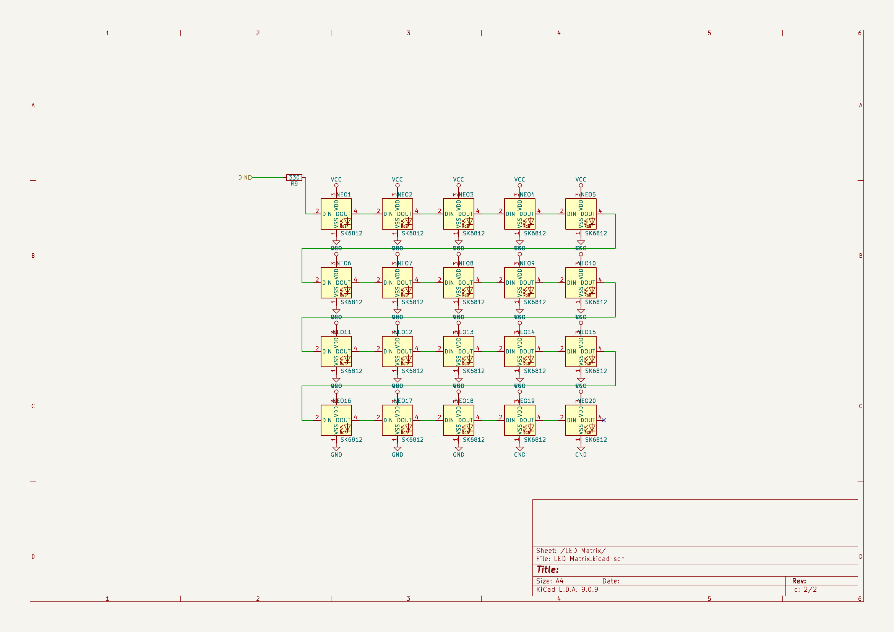
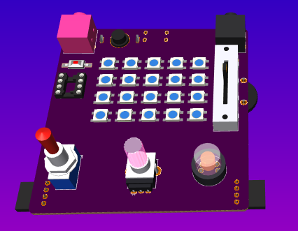
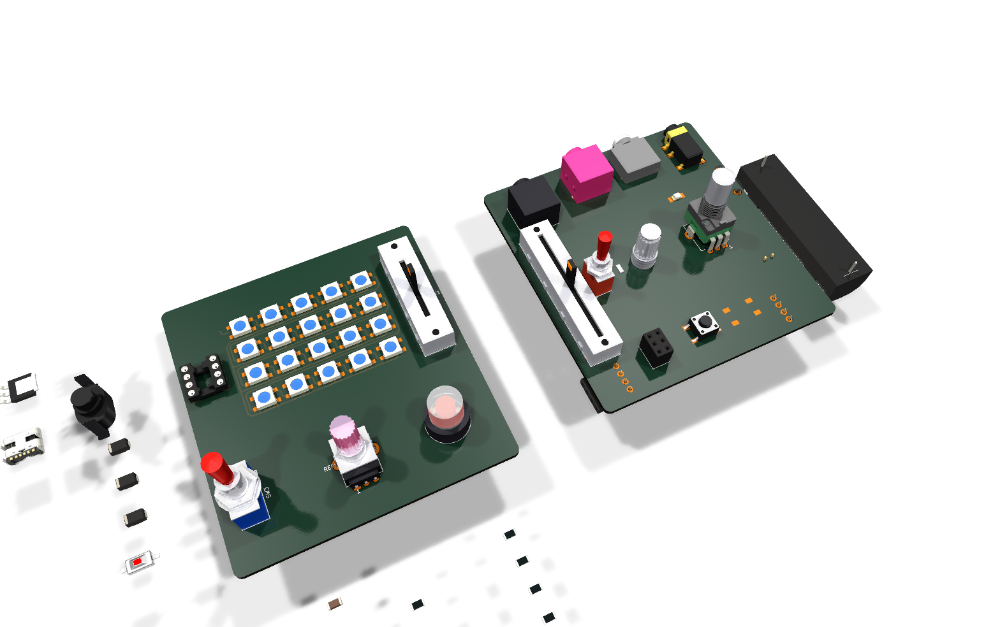
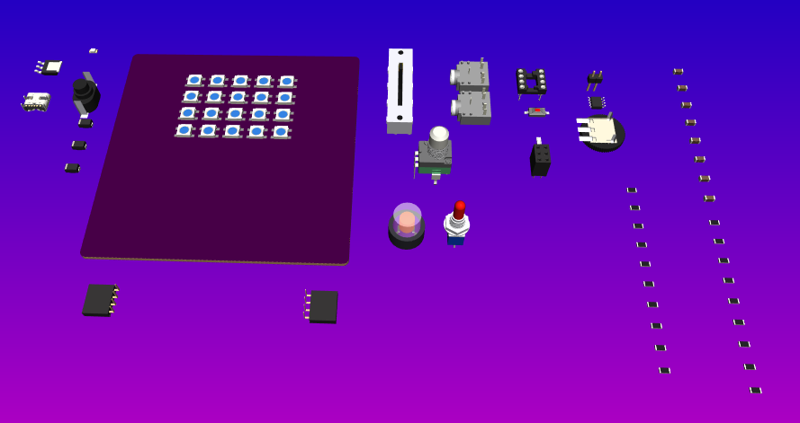
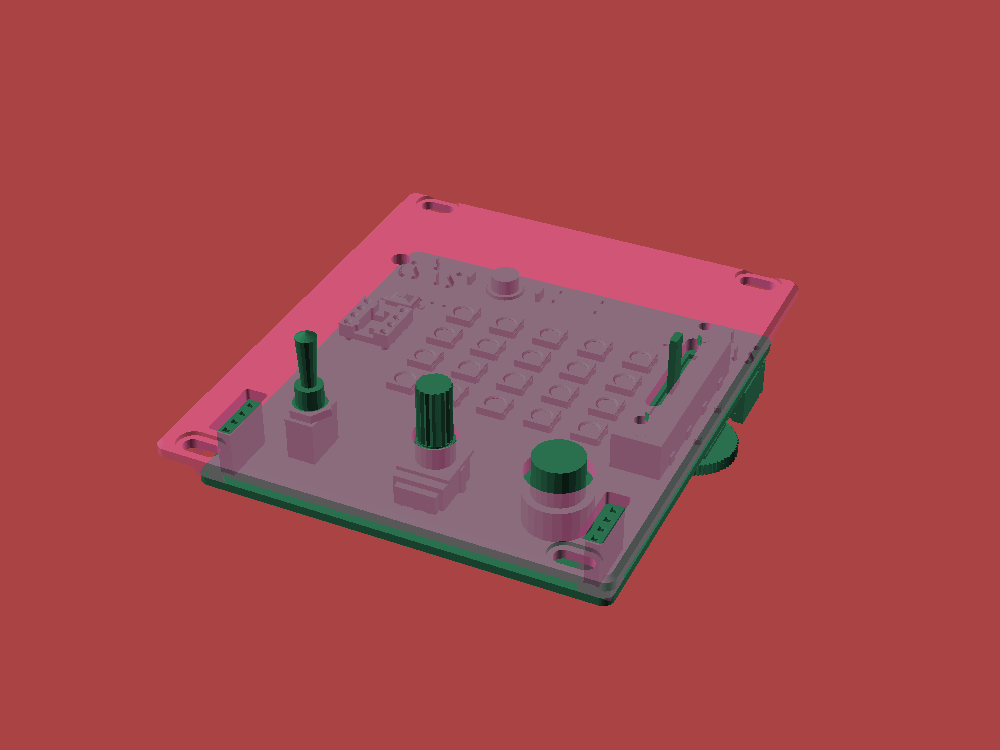
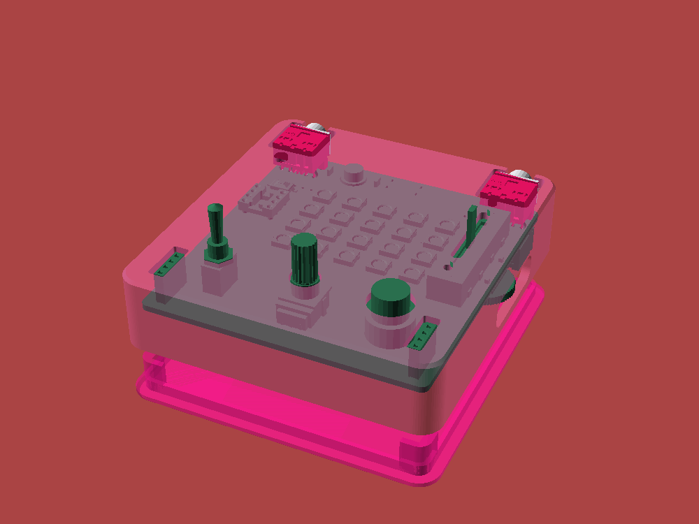
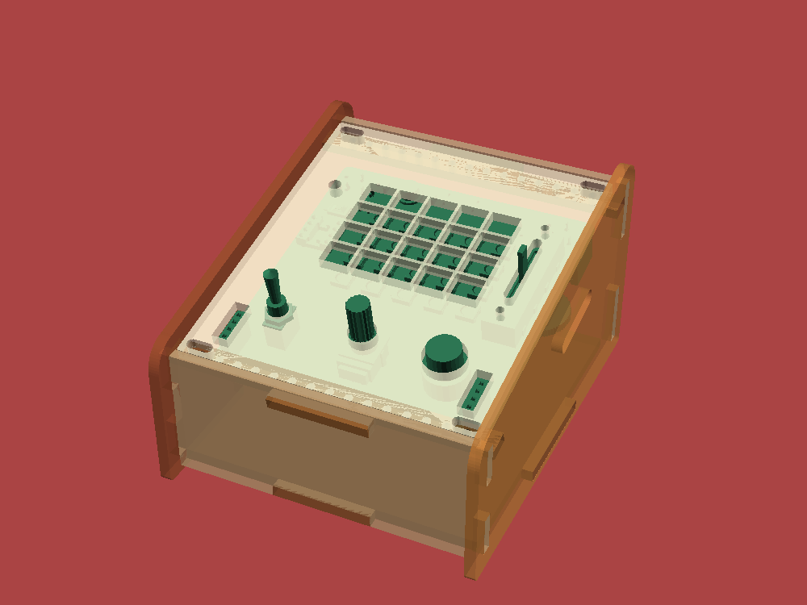
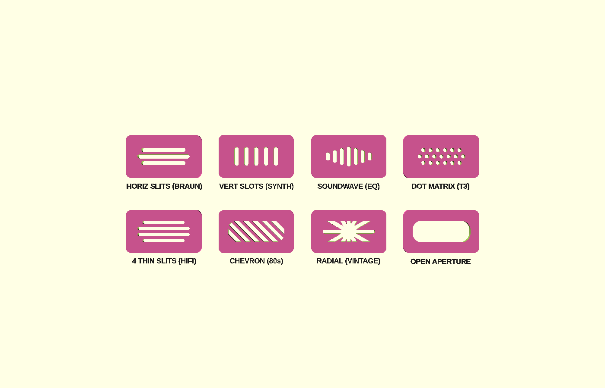

# ABK-20

**8-Bit Algorithmic Audio Synthesizer with 5×4 NeoPixel Matrix Display**

[](https://www.kicad.org/)
[](https://www.microchip.com/en-us/product/attiny85)
[](https://www.oshwa.org/)
[](LICENSE)

<p align="center">
  
</p>

The **ABK-20** is a modernized desktop hardware console redesign of the legendary **8Bit Mixtape**. Powered by a Microchip ATtiny85 running an 8-bit algorithmic sound engine (bytebeats, wavetable, granular, and punk console synths), it features an illuminated **20-LED (5×4) visual display screen**, tactile physical controls, and instant sound sketch loading via the **AudioBoot** bootloader.

---

## Hardware Highlights

* **Microcontroller**: Microchip ATtiny85 running at 16 MHz (Internal PLL).
* **Visual Display**: **20x WS2812B / SK6812 RGB NeoPixels** arranged in a 5-column × 4-row matrix for expressive animations, meters, and UI feedback.
* **Illuminated Slide Fader**: Bourns PTL20 20mm slide potentiometer with an integrated lever LED tied to the status/data line (`PB0`).
* **Tactile Controls**:
  * **Illuminated Rotary Potentiometer**: 10kΩ vertical potentiometer (`POT2-CV1` on `PB4`, RV09 / Alpha RD901F compatible) with illuminated transparent knurled shaft.
  * **Master Volume Control**: Side-mounted thumbwheel potentiometer (`POT3-Vol1`).
  * **Navigation Switch**: MTS-102 sub-miniature toggle switch (`SW3`) on `PB3` for menu navigation and mode selection.
  * **Illuminated User Button**: Highly KS01-BL-13 round illuminated push button (`SW2`) on the `PB3` resistor ladder.
  * **Hardware Reset Button**: Dedicated tactile push button (`SW4`) pulling `PB5` (Reset) to ground.
* **Audio Circuit**:
  * High-speed 8-bit PWM audio synthesized via Timer1 64 MHz PLL.
  * On-board PAM8002 audio amplifier optimized for unity gain ($R_{14} = 22\text{k}\Omega$, $C_5 = 1\mu\text{F}$, $C_8 = 100\text{nF}$) to prevent clipping and preserve deep sub-bass bytebeats through the internal speaker.
  * 3.5mm stereo output jack (switchable line-out / headphones with volume control).
* **AudioBoot Programming**: Upload new sound sketches directly through an audio cable or web browser—no external programmer or USB serial driver required.
* **Power Circuit**:
  * **USB-C 5V Input**: Modern 6-pin USB-C receptacle (`J5`) with dual 5.1kΩ pull-down resistors (`R17`, `R18` on CC1/CC2) for universal compatibility with USB-PD smart chargers and MacBook Type-C ports.
  * **Diode OR-ing Protection**: Automatic seamless power switching via Schottky diodes (`SS14`) across USB-C (5V), 7805 DC In (7–12V), and 3x AAA Battery input with reverse-charge protection.
  * **Master Power Switch**: Latching push switch (`SW1`) with power status LED (`D-POW1`). Cycling `SW1` provides the exact power-cycle timing required to activate AudioBoot sketch loading.

---

## Schematic

The ABK-20 schematic is organized into a modular **KiCad 9 hierarchical architecture**:

### Page 1: Main Architecture & Sound Engine
Controls, ATtiny85 microcontroller, audio filtering, power regulation, and hierarchical sub-sheet block.

<p align="center">
  
</p>

### Page 2: 5×4 NeoPixel Display Matrix
Dedicated hierarchical sub-sheet (`hardware/LED_Matrix.kicad_sch`) with the raster-scan daisy-chained 20-LED array.

<p align="center">
  
</p>

📄 **[Download Complete Multi-Page Schematic PDF (A4)](docs/hardware/ABK-20_schematic.pdf)**

---

## PCB Layout & 3D Model View

The compact **75×80 mm** rounded-corner desktop PCB design features the centered 5×4 NeoPixel display matrix, framed by the Bourns illuminated slide fader, clear-shaft illuminated rotary potentiometer, 3-way toggle switch, tactile buttons, thumbwheel volume pot, audio jacks, and side expansion headers:

<p align="center">
  
</p>

### Hardware Variants & Comparison Showroom
The repository includes a dedicated standalone showroom board ([`ABK-20_showcase_variants.kicad_pcb`](hardware/ABK-20_showcase_variants.kicad_pcb)) for mechanical verification, 3D rendering, and rapid component swapping across various hardware options:
* **Audio Jacks**: PJ-317 vertical, PJ-342 SMD gullwing, and CUI SJ1-3525N horizontal jacks.
* **Faders & Pots**: 20mm and 30mm Bourns slide pots, Alpha RD901F vertical, and 16mm back-pad pots.
* **Power & Battery**: 3x AAA on-board battery clip holders, barrel jack, and USB-C.

<p align="center">
  
</p>

### Component Staging & Exploration
Earlier component staging layout used during initial mechanical fit checks, 3D VRML model validation, and footprint library curation:

<p align="center">
  
</p>

---

## Frontplate & Enclosure Ecosystem

The repository provides fully parametric OpenSCAD designs and production deliverables in [`production/`](production/):

### 1. Parametric 3D-Printed Frontplate (`production/ABK20-case/`)
A dedicated OpenSCAD front panel ([`ABK-20_frontplate_3dprint.scad`](production/ABK20-case/ABK-20_frontplate_3dprint.scad)) designed for standard 16 HP ($80.96 \times 92.28\text{ mm}$) Eurorack rails or the desktop laser-cut chassis:
* **Integrated 5×4 Baffle Grid**: Extends downward to the PCB to completely isolate each NeoPixel and prevent optical light bleed between cells.
* **Selectable Matrix Styles** (via OpenSCAD Customizer):
  * **`diffuser_grid`**: Integrated $0.20\text{ mm}$ translucent 3D-printed diffuser skin (single-extruder M600 filament swap: white on bed, colored panel face).
  * **`open_frame_grid`**: Crisp open apertures with elegant top edge bevels.
  * **`window_recess`**: Stepped frame recess for an acrylic window insert.
* **Mounting & Cutouts**: M3 Eurorack mounting slots with counterbore recesses, underside PCB corner standoffs, and precise cutouts for the slide fader, pots, switches, buttons, and expansion headers.
* **Pre-Rendered STL**: [`ABK-20_frontplate_3dprint.stl`](production/ABK20-case/ABK-20_frontplate_3dprint.stl) and configuration presets in [`ABK-20_frontplate_3dprint.json`](production/ABK20-case/ABK-20_frontplate_3dprint.json).

<p align="center">
  
  &nbsp;&nbsp;&nbsp;&nbsp;
  
</p>

### 2. Laser-Cut Frontplates (`production/frontplate/`)
* **Vector Artwork Panels** ([`production/frontplate/ABK_frontplate_02.svg`](production/frontplate/ABK_frontplate_02.svg), [`output.pdf`](production/frontplate/output.pdf)): High-detail laser cutting and surface engraving artwork with silkscreen labeling and control indicators.

### 3. Parametric Enclosures (`production/ABK20-case/`)
* **3D-Printable Snap-Fit Enclosure** ([`ABK-20_case_3dprint.scad`](production/ABK20-case/ABK-20_case_3dprint.scad), [`.stl`](production/ABK20-case/ABK-20_case_3dprint.stl), [`.3mf`](production/ABK20-case/ABK-20_case_3dprint.3mf)):
  * Two-part direct-fit enclosure (`top_shell` + `bottom_cover`) designed for supportless FDM 3D printing with integrated 5×4 NeoPixel baffle grid.
  * **Prototype Hardware Support (Preset: `"perfect Proto"`)**: Specifically tailored for early prototype boards with top-mounted PJ-317 audio jacks. Adds beveled rectangular window cutouts ($14.5\times 15.5\text{ mm}$, $R=1.4\text{ mm}$) centered over each jack and widens lateral board clearance to $1.5\text{ mm}$ for effortless PCB insertion around the side thumbwheel volume pot.
  * **Standard Production (Preset: `"ABK-20_diffuser_grid"`)**: Solid continuous top face with rear-exiting audio jack ports.
* **Laser-Cut Desktop Console ("Chistli")** ([`ABK-20_case.scad`](production/ABK20-case/ABK-20_case.scad)):
  * Parametric finger-jointed desktop chassis in 3mm acrylic or wood with an ergonomic $12^\circ$ playing tilt.
  * Extended side cheeks with custom corner radii and Eurorack rail mounting options.
* **Enclosure Documentation**: [**`production/ABK20-case/README.md`**](production/ABK20-case/README.md) & [**`CASE_DESIGN_NOTES.md`**](production/ABK20-case/CASE_DESIGN_NOTES.md).

<p align="center">
  
  &nbsp;&nbsp;&nbsp;&nbsp;
  
</p>

### 4. Acoustic Optimization & Waveguide Engineering
The repository includes a comprehensive acoustic engineering architecture to solve the acoustic dipole short-circuit on rear-mounted micro-speakers and dramatically enhance bass/mid punch on physical hardware:
* **Master Engineering Plan**: [**`production/ABK20-case/ACOUSTIC_OPTIMIZATION_PLAN.md`**](production/ABK20-case/ACOUSTIC_OPTIMIZATION_PLAN.md)
  * **Downward Acoustic Chimney Waveguide**: Integrated directly into both the 3D-printed case ceiling and Eurorack faceplate. Tapers downward to seal against the PCB acoustic holes, transforming the $8.1\text{ mm}$ airspace into an acoustic horn with $+3\text{ to }+6\text{ dB}$ higher acoustic projection and zero internal sound spill.
  * **8 Classic Vintage Sound Grill Styles** (selectable via `speaker_grill_style`):
    * **`horiz_slots`**: Classic Dieter Rams / Braun T3 tiered horizontal slits.
    * **`horiz_4slots`**: 4 thin horizontal slits (retro 70s/80s Hi-Fi cassette deck).
    * **`soundwave`**: 7 graduated vertical slits forming an analog synth graphic EQ waveform.
    * **`braun_dots`**: 19-hole staggered precision dot matrix (Braun ET66 / T41).
    * **`chevron`**: $45^\circ$ angled Japanese synth louvers (Roland TR/TB style).
    * **`radial`**: 1950s transistor radio radial dial spoke starburst.
    * **`slots`**: Classic 5 vertical Eurorack slots.
    * **`aperture`**: Open framed window for real speaker cloth or brass wire mesh.
  * **Modular Acoustic Kit** ([`production/ABK20-case/ABK-20_speaker_acoustic_kit.scad`](production/ABK20-case/ABK-20_speaker_acoustic_kit.scad)):
    * Parametric sealed and Helmholtz bass-reflex back-box cups (Standard $2.4\text{ cm}^3$, XL $5.1\text{ cm}^3$, and MAX $6.3\text{ cm}^3$) with extended snorkel ducts tuned to $280-360\text{ Hz}$.
    * **Support-Free Printing**: Continuous flat PCB support keel at $Z = \text{depth}$ with $\le 45^\circ$ transitional chamfers prints 100% support-free when oriented flange-down.
  * **Precision Centering**: Added `panel_alignment = "symmetric"` to resolve legacy SVG viewBox offsets, achieving exact $2.98\text{ mm}$ symmetrical PCB margins and balanced top jack outer walls.

<p align="center">
  
</p>

---

## ATtiny85 Pin Mapping

| Pin | Physical | Port | Macro | Function / Description |
| :---: | :---: | :---: | :---: | :--- |
| **PB0** | Pin 5 | `PB0` | `NEOPIXELPIN` | 800 kHz data stream to 5×4 NeoPixel Matrix (via R9 330Ω) & Fader Lever LED (`RV1B`) |
| **PB1** | Pin 6 | `PB1` | `SPEAKERPIN` | High-speed PWM audio output (Timer1 64 MHz PLL) to Volume Pot & PAM8002 amp |
| **PB2** | Pin 7 | `PB2` | `POTI_LEFT` | Slide Potentiometer (`RV1A`) analog control input (ADC1) |
| **PB3** | Pin 2 | `PB3` | `BUTTON_PIN` | AudioBoot audio input (AC-coupled 100nF) & multi-state button resistor ladder (ADC3) |
| **PB4** | Pin 3 | `PB4` | `POTI_RIGHT` | 10kΩ Rotary Potentiometer (`POT2-CV1`) analog control input (ADC2) |
| **PB5** | Pin 1 | `PB5` | `RESET_PIN` | Hardware Reset button (`SW4`) & Sync jumper (`J6`). *(Can be converted to MIDI IN with `RSTDISBL`)* |

---

## Firmware & Web Flasher

* **[ABK-20 Online Web Audio Player & Flasher](https://8bitmixtape.github.io/ABK-20/)** (hosted directly from [`web/index.html`](web/index.html))
* **[Software & Sketches Suite](software/)** (PlatformIO build environment, `hex2wav` pipeline, and 30+ sound sketches)
* Also compatible with the [8Bit-Vintage Firmware Repository](https://github.com/8BitMixtape/8Bit-Vintage)

---

## TinyAudioBoot Bootloader (ABK-20 Custom Edition)

The ABK-20 features a dedicated, highly optimized build of **TinyAudioBoot** for ATtiny85 running at 16 MHz internal PLL, fully documented in [**`software/tools/bootloader/`**](software/tools/bootloader/):

* **Skipper Edition** ([`TinyAudioBoot_Skipper_ABK-20.hex`](software/tools/bootloader/hex/TinyAudioBoot_Skipper_ABK-20.hex), 960 bytes):
  * **Instant Boot**: Starts the active synthesizer sketch in $< 25\text{ ms}$ upon normal power-on.
  * **Upload Mode on Demand**: Enters a 30-second audio upload window *only* when holding button **`SW2`** during power-up or reset.
* **Standard Edition** ([`TinyAudioBoot_Standard_ABK-20.hex`](software/tools/bootloader/hex/TinyAudioBoot_Standard_ABK-20.hex), 874 bytes):
  * Provides an automatic 5-second audio upload window on every power cycle.
* **Silent Standby on PB1**:
  * Actively clamps `PB1` to GND during bootloader standby so there are zero pops, clicks, or 1 Hz ticking chirps in headphones or speaker.
* **Page-Write Bi-Color Visuals**:
  * Alternates **Green $\leftrightarrow$ Red** on every 64-byte flash page write for real-time visual progress monitoring.
* **Flash Budget**:
  * Occupies $\le 1\text{ KB}$ at address `0x1C00`, maximizing flash memory to **7,168 bytes** ($0\text{x0000} \to 0\text{x1BFF}$) for user sketches.
* **ISP Flashing & Fuses**:
  * Quick one-liner AVRDUDE flash commands and fuse reference (`lfuse: 0xe1`, `hfuse: 0xdd`, `efuse: 0xfe`) are detailed in [**`software/tools/bootloader/burn_bootloader.md`**](software/tools/bootloader/burn_bootloader.md).
* **Architecture & Evolution**:
  * Comprehensive breakdown of all circuit and firmware differences compared to the original v3.0–v3.2 bootloader in [**`software/tools/bootloader/BOOTLOADER_EVOLUTION_AND_DIFFERENCES.md`**](software/tools/bootloader/BOOTLOADER_EVOLUTION_AND_DIFFERENCES.md).

---

## Repository Structure

```
ABK-20/
├── .agents/                          # Antigravity agent rules & 8Bit Mixtape skills
├── web/                              # Web AudioBoot player & sound app catalog (GitHub Pages)
│   ├── index.html                    # Online Web Audio Flasher & synthesizer player
│   ├── apps.json & apps.js           # Sound track catalog metadata & registry
│   ├── wav/                          # Production 8-bit bootloader audio streams (.wav)
│   ├── audio/                        # 30-second audio preview MP3s
│   ├── gifs/                         # Animated 5x4 matrix LED previews (solid clean mode)
│   └── manuals/                      # Individual user manuals for each sound application
├── docs/                             # Project documentation, hardware notes & datasheets
│   ├── hardware/                     # Circuit notes, engineering summaries & schematics
│   │   ├── HARDWARE_NOTES.md         # Hardware & circuit design notes
│   │   ├── REV03_ENGINEERING_SUMMARY.md # Engineering breakdown
│   │   ├── AMP_AUTO_SHUTDOWN_CIRCUIT.md # LM4871 amp shutoff specification
│   │   ├── DESIGN_VARIANTS_GUIDE.md  # Alternative layout variants
│   │   └── ABK-20_schematic.pdf      # Multi-page A4 schematic export
│   ├── datasheets/                   # Component datasheets (Bourns faders, switches, pots)
│   ├── fabrication/                  # DIY etching & drilling guides (ABK-20_DIY_DRILL_HANDOUT.pdf)
│   ├── history/                      # 8Bit Mixtape lineage & Coconut doctrine (HISTORY_AND_ARCHITECTURE.md)
│   ├── software/                     # Software developer guides (WORKFLOW_GIF_GENERATION.md)
│   └── img/                          # Images, 3D renders & diagrams
├── hardware/                         # KiCad 8 EDA design source files
│   ├── ABK-20.kicad_pro              # KiCad project file
│   ├── ABK-20.kicad_sch              # Main hierarchical schematic (Page 1)
│   ├── LED_Matrix.kicad_sch          # 5x4 NeoPixel matrix sub-sheet (Page 2)
│   ├── ABK-20.kicad_pcb              # Main 75x80 mm PCB board layout
│   ├── ABK-20_showcase_variants.kicad_pcb # Standalone showroom board with alternative footprints
│   ├── mixtape_schematics.kicad_sym  # Project symbol library
│   ├── 8Bitmixtape_reworked.pretty/  # Project footprint library
│   ├── 3d_models/                    # Self-contained bundled 3D models
│   ├── bom/                          # Hardware schematic BOM exports
│   └── scripts/                      # Layout, 3D WRL & thumbnail scripts
├── production/                       # Physical manufacturing & fabrication deliverables
│   ├── bom/                          # Interactive HTML Bill of Materials (iBOM)
│   ├── gerbers/                      # Standard fabrication drill & Gerber archives
│   ├── MASK/                         # High-res vector masks for DIY PCB chemical etching
│   ├── frontplate/                   # Laser-cut / CNC front panel vector drawings (SVG)
│   └── ABK20-case/                   # 3D printable enclosures and mechanical drawings
└── software/                         # Embedded C++ firmware, tools & asset pipelines
    ├── platformio.ini                # PlatformIO ATtiny85 @ 16 MHz build configuration
    ├── src/                          # 30+ algorithmic sound sketches (.cpp)
    ├── include/                      # Hardware pinouts & shared sound engine headers (.h)
    ├── scripts/                      # Asset pipelines (build_wavs, gen_previews, gen_audio_previews)
    └── tools/
        ├── bootloader/               # TinyAudioBoot sources, Makefile & precompiled HEX binaries
        └── hex2wav/                  # Standalone Hex-to-Audio bootloader converter
```

---

## License

Licensed under the **[CERN Open Hardware Licence Version 2 – Strongly Reciprocal](LICENSE)** (CERN-OHL-S-2.0).

