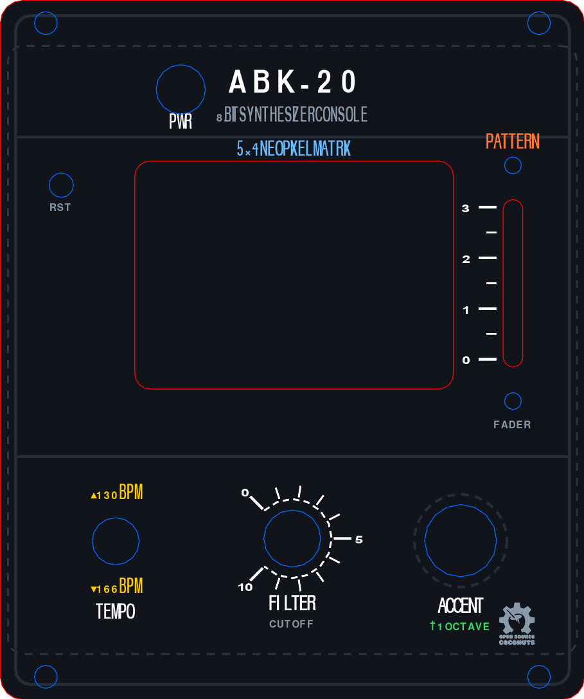
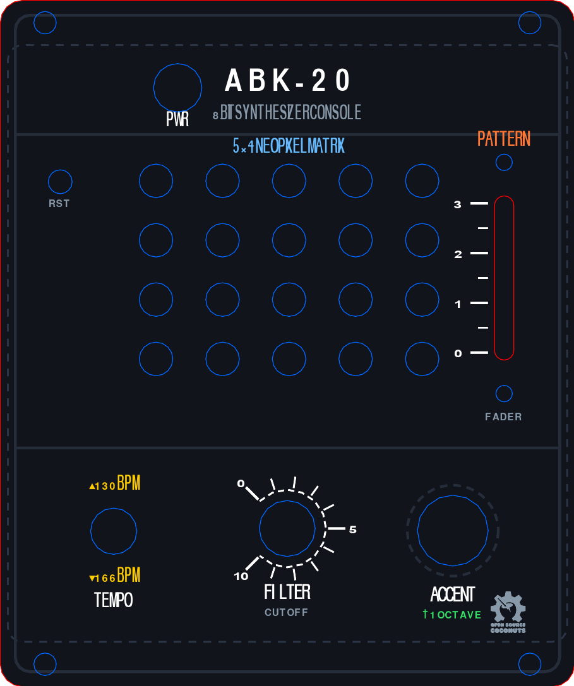

# ABK-20 Frontplate Mechanical Specification & Fabrication Guide

This document defines the 1:1 mechanical specifications, coordinate placements, hole diameters, and fabrication instructions for the **ABK-20** desktop synthesizer frontplate.

All component coordinates are derived directly from the KiCad PCB layout (`hardware/ABK-20.kicad_pcb`), offset to center the PCB with the requested enclosure overhangs.

---

## Visual Previews

| Window Cutout ($42\times 30\text{ mm}$ Bezel) | Discrete Circular Apertures (20x $\varnothing 4.5\text{ mm}$) |
| :---: | :---: |
|  |  |

---

## 1. Overall Panel Dimensions & Overhangs

* **PCB Dimensions**: $75.0\text{ mm}$ (width) $\times 80.0\text{ mm}$ (height)
* **Overhangs**:
  * **Sides (Left & Right)**: $+1.0\text{ mm}$ overhang on each side ($2.0\text{ mm}$ total width expansion).
  * **Top & Bottom**: $+6.0\text{ mm}$ overhang on top and bottom ($12.0\text{ mm}$ total height expansion).
* **Total Frontplate Dimensions**: **$77.0\text{ mm}$ (width) $\times 92.0\text{ mm}$ (height)**
* **Corner Radius**: $R = 3.0\text{ mm}$
* **PCB Placement on Frontplate**:
  * Left edge of PCB is at $X = 1.0\text{ mm}$, right edge at $X = 76.0\text{ mm}$.
  * Top edge of PCB is at $Y = 6.0\text{ mm}$, bottom edge at $Y = 86.0\text{ mm}$.
  * Coordinate translation formula from KiCad PCB:
    $$X_{\text{plate}} = X_{\text{pcb}} + 1.0\text{ mm}$$
    $$Y_{\text{plate}} = Y_{\text{pcb}} + 6.0\text{ mm}$$

---

## 2. Component Cutouts & Placement Reference Table

*Coordinates below are given in Frontplate coordinates $(X, Y)$ with Origin $(0, 0)$ at the Top-Left of the $77\times 92\text{ mm}$ frontplate:*

| RefDes | Component | Center $(X, Y)$ [mm] | Feature Shape | Tooling Size | Purpose / Notes |
| :--- | :--- | :---: | :--- | :--- | :--- |
| **`SW1`** | Power Switch | $(23.782, 11.728)$ | Circle | $\varnothing 6.5\text{ mm}$ | Latching push switch button plunger |
| **`SW4`** | Hardware Reset | $(8.033, 24.326)$ | Pinhole | $\varnothing 3.2\text{ mm}$ | Tactile reset access hole (pin / stylus) |
| **`RV1`** | Bourns PTL20 Slide Fader | $(67.561, 37.218)$ | Pill Slot | $2.6\text{ mm} \times 22.0\text{ mm}$ | Lever travel ($20\text{ mm}$ active travel) |
| **`RV1-T`**| Fader Top Mount | $(67.561, 21.718)$ | Circle | $\varnothing 2.2\text{ mm}$ | M2 countersunk mounting screw |
| **`RV1-B`**| Fader Bottom Mount | $(67.561, 52.718)$ | Circle | $\varnothing 2.2\text{ mm}$ | M2 countersunk mounting screw |
| **`SW3`** | MTS-102 SPDT Toggle | $(15.203, 71.165)$ | Circle | $\varnothing 6.2\text{ mm}$ | M6 threaded bushing & retaining nut |
| **`POT2`** | RV09 Rotary Potentiometer | $(38.473, 70.804)$ | Circle | $\varnothing 7.5\text{ mm}$ | RV09 collar & clear knurled shaft |
| **`SW2`** | Highly KS01-BL-13 Button | $(60.669, 71.087)$ | Circle | $\varnothing 9.5\text{ mm}$ | Upper plunger cap clearance ($9.0\text{ mm}$ cap; $12\text{ mm}$ collar trapped underneath) |
| **`CASE-1`**| Top-Left Flange Mount | $(6.000, 3.000)$ | Screw Hole | $\varnothing 3.0\text{ mm}$ | In 6mm top overhang (M2.5 / M3) |
| **`CASE-2`**| Top-Right Flange Mount | $(71.000, 3.000)$ | Screw Hole | $\varnothing 3.0\text{ mm}$ | In 6mm top overhang (M2.5 / M3) |
| **`CASE-3`**| Bottom-Left Flange Mount | $(6.000, 89.000)$ | Screw Hole | $\varnothing 3.0\text{ mm}$ | In 6mm bottom overhang (M2.5 / M3) |
| **`CASE-4`**| Bottom-Right Flange Mount| $(71.000, 89.000)$ | Screw Hole | $\varnothing 3.0\text{ mm}$ | In 6mm bottom overhang (M2.5 / M3) |

---

## 3. 5×4 NeoPixel Display Matrix Aperture Options

The 20 NeoPixels (`NEO1`–`NEO20`) form a 5-column $\times$ 4-row grid centered at $(38.724, 36.137)\text{ mm}$ on the frontplate:
* **Columns ($X$)**: $20.880, 29.801, 38.723, 47.645, 56.567\text{ mm}$
* **Rows ($Y$)**: $24.199, 32.158, 40.116, 48.075\text{ mm}$

### Option A: Display Window Cutout (`ABK-20_frontplate.svg`)
* Single rectangular bezel cutout: **$42.0\text{ mm} \times 30.0\text{ mm}$** with $R = 2.0\text{ mm}$ rounded corners.
* Center: $(38.724, 36.137)\text{ mm}$.
* Recommended for: Frontplates with a smoked acrylic, frosted diffuser, or 3D-printed window insert.

### Option B: Discrete Circular Apertures (`ABK-20_frontplate_discrete_leds.svg`)
* 20 individual circular holes of **$\varnothing 4.5\text{ mm}$** centered at each NeoPixel location.
* Recommended for: Direct retro panel aesthetics where each LED shines through its own aperture.

---

## 4. Mechanical Assembly & Standoffs

* **PCB-to-Panel Spacing**: **$5.0\text{ mm}$ to $6.0\text{ mm}$** standoff height.
* **Fastening / Clamping**:
  1. The M6 retaining nut on `SW3` and collar on `POT2` clamp the panel securely to the PCB.
  2. Two M2 countersunk screws mount `RV1` directly to the panel face.
  3. Four $\varnothing 3.0\text{ mm}$ mounting holes in the top ($Y=3.0$) and bottom ($Y=89.0$) overhang flanges fasten the panel directly into your enclosure chassis or 3D-printed case.

---

## 5. Output Files in `hardware/`

* [`ABK-20_frontplate.svg`](ABK-20_frontplate.svg) — Master production SVG ($77\times 92\text{ mm}$, Window style).
* [`ABK-20_frontplate_discrete_leds.svg`](ABK-20_frontplate_discrete_leds.svg) — Production SVG ($77\times 92\text{ mm}$, 20 Discrete holes style).
* [`../scripts/generate_frontplate.py`](../scripts/generate_frontplate.py) — Standalone Python generator script.
