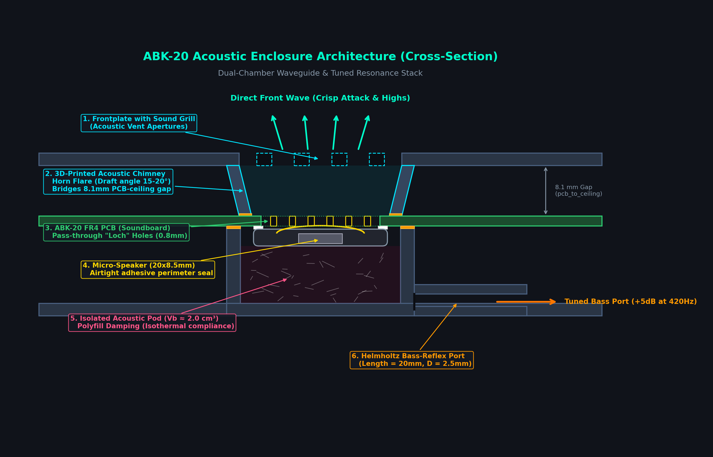
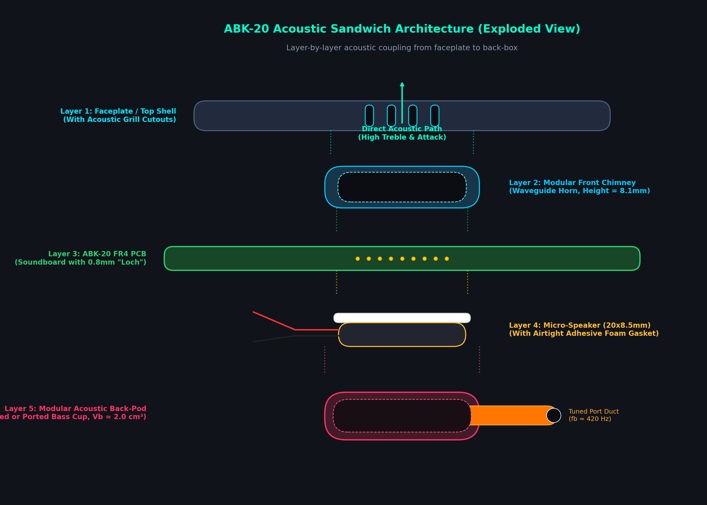
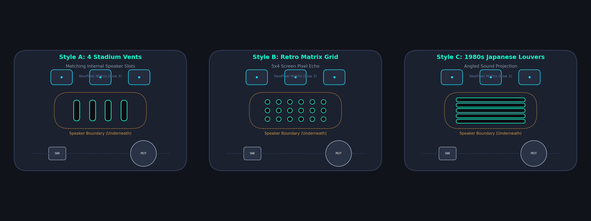
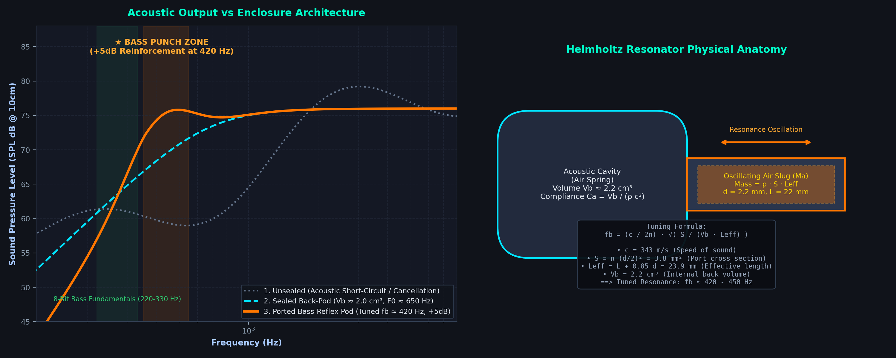
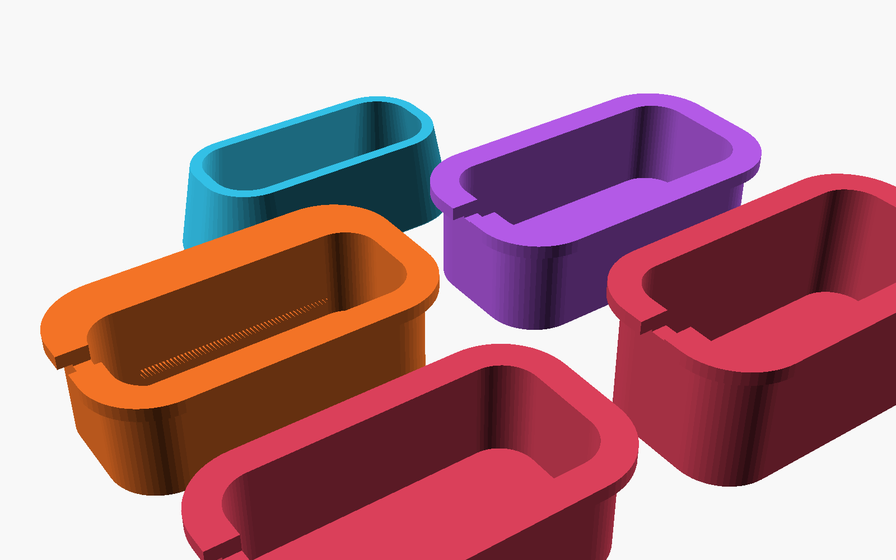
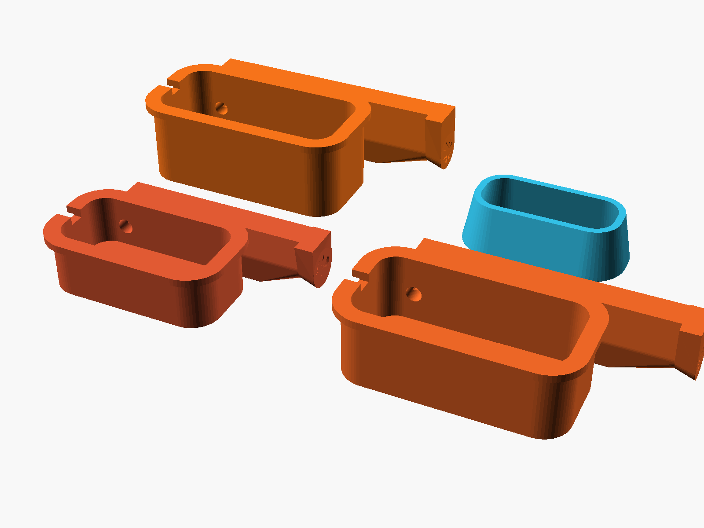
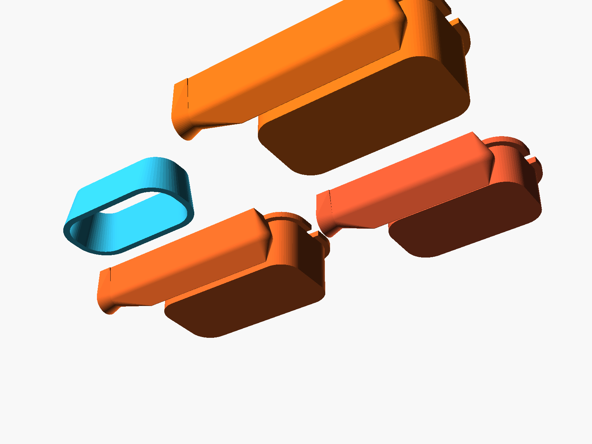
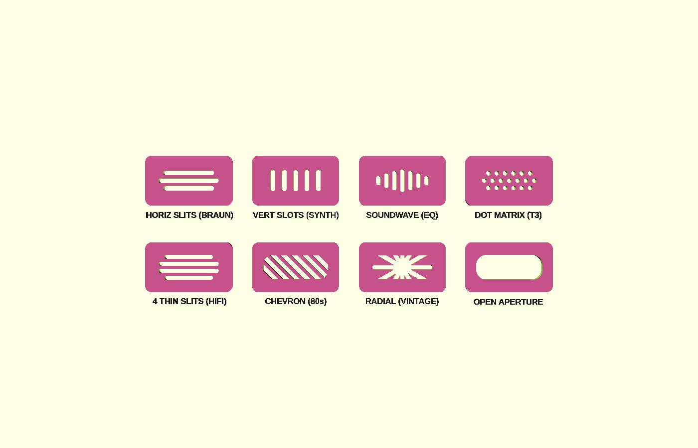

# HiFi Audio & Acoustic Optimization Plan for ABK-20 Enclosures

This document serves as the master engineering reference for optimizing acoustic output, frequency response, and bass reproduction from the rear-mounted micro-speaker on the ABK-20 synthesizer in 3D-printed and laser-cut enclosures.



---

## Table of Contents
1. [Physical Architecture & The Dipole Problem](#1-physical-architecture--the-dipole-problem)
2. [Front Acoustic Impedance: The PCB "Loch" Design](#2-front-acoustic-impedance-the-pcb-loch-design)
3. [Frontplate Acoustic Coupling: The Acoustic Chimney Waveguide](#3-frontplate-acoustic-coupling-the-acoustic-chimney-waveguide-horn)
4. [Back Cavity Engineering: The Enclosure Cabinet](#4-back-cavity-engineering-the-enclosure-cabinet)
5. [Laser-Cut Enclosure ("Chistli") Implementation](#5-laser-cut-enclosure-chistli-implementation)
6. [PCB Soundboard Principle (Distributed Mode Loudspeaker)](#6-pcb-soundboard-principle-distributed-mode-loudspeaker)
7. [Acoustic Polyfill (Chamber Stuffing)](#7-acoustic-polyfill-chamber-stuffing)
8. [Electrical Power & DSP / Software Bass Tuning](#8-electrical-power--dsp--software-bass-tuning)
9. [Ready-to-Test 3D CAD Reference Sketch](#9-ready-to-test-3d-cad-reference-sketch)
10. [Modular 3D-Printable Acoustic Kit](#10-modular-3d-printable-acoustic-kit-abk-20_speaker_acoustic_kitscad)
11. [Expanded Acoustic Kit: XL/MAX Volumes & Audition Plates](#11-expanded-acoustic-kit-xlmax-volumes--audition-plates)
12. [Support-Free Printing & The Continuous PCB Support Keel](#12-support-free-printing--the-continuous-pcb-support-keel)
13. [Direct Enclosure Integration & Precision Centering](#13-direct-enclosure-integration--precision-centering)
14. [Classic Acoustic Grill Designs](#14-classic-acoustic-grill-designs)

---

## 1. Physical Architecture & The Dipole Problem



```
               Front Wave (Crisp Treble & Attack)
                      ▲ ▲ ▲
  ════════════════════╧═╧═╧═══════════════════════════   <-- Frontplate with Sound Grill
        \                                       /
         \       3D-PRINTED ACOUSTIC CHIMNEY   /         <-- Waveguide Horn (Bridges 8.1mm Gap)
          \                                   /
  ┌────────┤      [ Acoustic Loch ]          ├────────┐  <-- ABK-20 FR4 PCB (Soundboard)
  │        ├─────────────────────────────────┤        │
  │     ╔══╧═════════════════════════════════╧══╗     │
  └─────╫    Micro-Speaker (Adhesive Seal)      ╫─────┘
        ║    diaphragm [===] voice coil         ║
        ╚═══════════════════════════════════════╝
                      │ │ │
                      ▼ ▼ ▼
           [ Sealed Back Chamber Pod / Port ]          <-- Bottom Case (Vb ≈ 2.0 cm³)
```

### The Acoustic Short-Circuit
The speaker is an electrodynamic transducer ($\approx 20 \times 8.5\text{ mm}$, $S_d \approx 80\text{ mm}^2$, $F_0 \approx 700 - 1000\text{ Hz}$).
When the diaphragm moves, it generates two opposing waves:
* **Front Wave**: Radiates through the "loch" acoustic holes in the PCB.
* **Back Wave**: Radiates $180^\circ$ out-of-phase from the rear of the speaker.

Without an airtight barrier separating the two waves, destructive acoustic cancellation completely eliminates sound below $\approx 1\text{ kHz}$.

### Rule #1: The Perimeter Gasket Seal
* The speaker's white double-sided adhesive ring must form an **unbroken, airtight seal against the bottom copper/FR4 plane** around the "loch".
* Any air leak around the perimeter of the speaker frame will cause immediate loss of low-frequency response.

---

## 2. Front Acoustic Impedance: The PCB "Loch" Design

The PCB is 1.6 mm thick FR4. Each hole acts as an acoustic pipe of length $L = 1.6\text{ mm} + \text{end corrections} \approx 2.3\text{ mm}$.
If the open hole area is too small, air velocity in the holes causes viscous boundary-layer friction, choking high frequencies and generating port turbulence/chuffing noise.

### Footprint Options in `hardware/8Bitmixtape_reworked.pretty/`:
* **Option A (`Speaker_Micro_Loch_4x3`)**: 12 round holes ($\varnothing 0.8\text{ mm}$), $A \approx 6.0\text{ mm}^2$.
* **Option B (`Speaker_Micro_Loch_4Slots`)**: 4 milled slots ($0.8 \times 2.8\text{ mm}$), $A \approx 9.0\text{ mm}^2$. Directly aligns with the 4 physical speaker sound vents.
* **Option C (`Speaker_Micro_Loch_Honeycomb`)**: 19 round holes ($\varnothing 0.8\text{ mm}$), $A \approx 9.55\text{ mm}^2$. Classic synthesizer acoustic grill.

> **Recommendation**: **Option B** or **Option C** provides the lowest acoustic inertance and lowest viscous losses ($\ge 35\%$ aperture ratio).

---

## 3. Frontplate Acoustic Coupling: The "Acoustic Chimney" (Waveguide Horn)

In `production/ABK20-case/ABK-20_case_3dprint.scad`, there is a vertical distance of **$8.1\text{ mm}$** between the top of the PCB and the ceiling of the faceplate (`pcb_to_ceiling = 8.1` to clear pots, LEDs, and switches).

### The Danger of Trapped Sound
Without dedicated frontplate apertures and an acoustic duct:
1. **Treble Muffling**: Sound exiting the PCB holes bounces inside the $\approx 48\text{ cm}^3$ airspace beneath the faceplate, acting like an accidental low-pass filter.
2. **Component Rattling**: Trapped sound pressure forces air out through the slide fader slot, potentiometer holes, and button openings, creating buzzes and rattles.

### The Solution: 3D-Printed Acoustic Chimney (Funnel)
A stadium-shaped chimney wall extends downward from the faceplate ceiling to meet the PCB surface:
* **Direct Path**: 100% of the sound from the PCB loch is funneled straight out through the faceplate grill.
* **Horn Loading Effect**: By tapering the chimney outward from the PCB ($21.4 \times 8.4\text{ mm}$) to the faceplate ($24.4 \times 11.4\text{ mm}$) with a $15^\circ - 20^\circ$ draft flare:
  * Acts as an acoustic impedance transformer (conical horn).
  * **Result**: **$+3\text{ dB to }+6\text{ dB}$ higher acoustic output** and sharper transient response with zero extra power consumption!
* **Printability**: Because `ABK-20_case_3dprint.scad` prints upside-down (faceplate flat on the print bed), the chimney walls print vertically upward with **zero supports required**.



### Frontplate Grill Styles:
The faceplate grill can be configured to any of the 8 classic acoustic designs detailed in [Section 14](#14-classic-acoustic-grill-designs), including Dieter Rams horizontal slits (`horiz_slots`), analog synth graphic EQ waveform (`soundwave`), precision dot matrix (`braun_dots`), and 5 vertical slots (`slots`).

---

## 4. Back Cavity Engineering: The Enclosure Cabinet

The bottom enclosure shell should be designed as a miniature loudspeaker cabinet rather than an open tub.



### Approach 1: Integrated 3D-Printed Acoustic Cup / Pod
In `production/ABK20-case/ABK-20_case_3dprint.scad`:
1. **Cup Geometry**:
   * Add a rectangular or stadium-shaped wall rising from the bottom case floor that mates against the back of the PCB surrounding the speaker footprint.
   * Coordinate center: `speaker_pcb_x = 0.223 mm`, `speaker_pcb_y = -12.565 mm` in PCB-centered coordinates (matching KiCad `SPK1` footprint at absolute coordinates `114.94, 81.23`).
   * Wall thickness: $1.2 - 1.6\text{ mm}$ (3-4 perimeters for zero air leakage).
   * Top rim: Optional $0.5\text{ mm}$ groove for a soft silicone bead or compressed closed-cell EVA foam gasket.
2. **Back Volume ($V_b$) Target**:
   * Target volume: $V_b \approx 1.5 - 3.0\text{ cm}^3$ ($1500 - 3000\text{ mm}^3$).
   * Maintaining $V_b \ge 2.0\text{ cm}^3$ keeps air spring stiffness low, allowing the driver to reach its maximum low-frequency excursion.
3. **Optional Tuned Bass-Reflex Port (Helmholtz Resonator)**:
   * A small duct integrated into the case bottom ($D = 2.5\text{ mm}$, Length $L = 20\text{ mm}$).
   * Helmholtz resonance formula:
     $$f_b = \frac{c}{2\pi} \sqrt{\frac{S}{V_b (L + 0.85 d)}}$$
   * With $c = 343\text{ m/s}$, $S = \pi \times 1.25^2 \approx 4.9\text{ mm}^2$, $V_b = 2.2\text{ cm}^3$, $L = 20\text{ mm}$:
     $$f_b \approx 420\text{ Hz}$$
   * This provides a $+5\text{ dB}$ acoustic reinforcement bump right at the fundamental punch frequency of 8-bit chip kicks, snares, and basslines!

### Approach 2: Sealed Lower Case (Infinite Baffle Mode)
For laser-cut stacked acrylic/wood cases (`production/ABK20-case/ABK-20_case.scad`):
* Place an unbroken EVA foam or silicone gasket along the perimeter shoulder where the PCB rests.
* Seal the USB-C and audio jack cutouts with snug silicone bezels.
* The entire lower cavity ($V_b \approx 30 - 45\text{ cm}^3$) acts as an acoustic suspension chamber.

---

## 5. Laser-Cut Enclosure ("Chistli") Implementation

In a laser-cut chassis such as `production/ABK20-case/ABK-20_case.scad`:
* **Faceplate**: The top 3.0 mm acrylic/plywood plate is laser-cut with the sound grill pattern directly centered over `speaker_pcb_x = 0.223 mm, speaker_pcb_y = -12.565 mm` (PCB-centered coordinates).
* **Acoustic Collar Spacer**:
  To bridge the air gap between the top surface of the PCB and the acrylic ceiling:
  * Cut a rectangular **EVA foam or silicone spacer collar** (outer $26 \times 13\text{ mm}$, inner $21 \times 8.5\text{ mm}$, thickness $8.0\text{ mm}$).
  * Sandwiched between the PCB and the frontplate, this lightweight collar forms a 100% airtight duct, channeling all acoustic energy straight through the laser-cut grill with zero internal spill!

---

## 6. PCB Soundboard Principle (Distributed Mode Loudspeaker)

The $75 \times 80\text{ mm}$ 1.6mm FR4 PCB acts as a sounding board:
* **Natural Plate Mode**:
  Clamped at the 4 standoff corners, the fundamental flexural bending mode $(1,1)$ of the board occurs at $\approx 280 - 380\text{ Hz}$, aligning with the middle octave of bass synths.
* **Off-Center Driver Placement**:
  The speaker at `(X = +0.22 mm, Y = -12.57 mm)` is slightly off-center. Symmetrical center placement produces harsh cancellation notches; off-center excitation distributes modal energy across multiple plate resonances smoothly.
* **Mechanical Decoupling**:
  To prevent plastic/metal rattles against the enclosure, mount the PCB using **M3 silicone / rubber O-rings** above and below the board at the 4 corner standoffs.

---

## 7. Acoustic Polyfill (Chamber Stuffing)

Inside the rear chamber:
* Insert a light pinch of polyester fiberfill or open-cell reticulated acoustic foam.
* **Acoustic Function**:
  1. Absorbs internal standing waves and prevents "boxy" mid-range coloration.
  2. Slows air velocity, converting adiabatic compression into isothermal compression.
  3. **Apparent Volume Increase**: Increases acoustic compliance by $15 - 20\%$, making a $2.0\text{ cm}^3$ pod behave acoustically like a $2.4\text{ cm}^3$ pod.

---

## 8. Electrical Power & DSP / Software Bass Tuning

* **Amplifier**: The onboard **PAM8002** Class-AB/D mono amplifier provides a **differential Bridge-Tied Load (BTL)** output capable of delivering $2.0 - 2.5\text{ W}$ into $4 - 8\ \Omega$ at $5\text{ V}$.
* **No Coupling Capacitors**: BTL drive eliminates DC-blocking output capacitors, preserving full low-frequency extension down to DC.
* **Psychoacoustic Bass (Virtual Pitch / Missing Fundamental)**:
  Micro-speakers physically cannot move enough air below $120\text{ Hz}$. In software bytebeat/synth routines, generating rich harmonic overtones (2nd harmonic at $160-240\text{ Hz}$, 3rd at $240-360\text{ Hz}$) causes the human brain to reconstruct the deep sub-bass pitch with high clarity and zero distortion.

---

## 9. Ready-to-Test 3D CAD Reference Sketch

A standalone OpenSCAD sketch modeling the complete 3D geometry of the chimney, grill, and rear back-box is available in:
📁 [`production/ABK20-case/acoustic_chimney_sketch.scad`](acoustic_chimney_sketch.scad)

It can be opened directly in OpenSCAD to inspect:
* `assembly_cutaway`: 3D quadrant cutaway showing faceplate, flared chimney, PCB with loch, speaker, and rear pod.
* `chimney_only`: Isolated 3D waveguide funnel.
* `pod_only`: Isolated rear acoustic pod with tuned bass port.
* `grills_showcase`: Side-by-side comparison of Styles A, B, and C.

---

## 10. Modular 3D-Printable Acoustic Kit (`ABK-20_speaker_acoustic_kit.scad`)

For fast prototyping and physical testing on real hardware without altering any case files:
📁 [**`production/ABK20-case/ABK-20_speaker_acoustic_kit.scad`**](ABK-20_speaker_acoustic_kit.scad)



### The 3 Modular Accessories:
1. **Sealed Back-Pod Cup (`back_pod_sealed`)**:
   * Sits over the speaker on the back of the PCB (`B.Cu`).
   * Dimensions: $26.0 \times 13.0\text{ mm}$, default depth $7.5\text{ mm}$ (fits easily within the existing $10.0\text{ mm}$ bottom case clearance).
   * Perimeter rim flange ($1.0\text{ mm}$) for easy bonding with thin double-sided acrylic foam tape or silicone adhesive.
   * Wire exit notch on the left end so red/black wires exit without pinch points.
   * Encloses an internal back volume of $V_b \approx 2.0\text{ cm}^3$.
2. **Ported Bass-Reflex Pod (`back_pod_ported`)**:
   * Same footprint as the sealed cup, but includes an integrated Helmholtz bass-reflex duct ($D = 2.5\text{ mm}$, $L = 16\text{ mm}$) tuned to $\approx 420\text{ Hz}$ for maximum mid-bass punch on 8-bit chip kicks.
3. **Front Waveguide Chimney (`front_chimney`)**:
   * Sits on the top surface of the PCB over the acoustic loch.
   * Height: $8.1\text{ mm}$ (matching `pcb_to_ceiling = 8.1`).
   * Tapered horn funnel ($15^\circ$ flare) directing all sound pressure straight out through the faceplate grill.

### Printing & Prototyping Recommendations:
* **Print Time**: $\approx 12-18\text{ minutes}$ for the entire kit on `print_plate`.
* **Layer Height**: $0.16\text{ mm}$ or $0.20\text{ mm}$.
* **Infill / Perimeters**: $\ge 3$ perimeters (or $100\%$ infill) to ensure dense, non-porous acoustic walls with zero air leakage.
* **Material**:
  * **PLA / PETG**: Rigid, crisp high-frequency projection.
  * **TPU 95A (Flexible)**: Ideal for the front chimney—the flexible rubber naturally conforms and self-seals against the PCB and faceplate with zero rattles!
* **Case Depth Flexibility**:
  If an even larger rear volume is desired ($V_b \ge 3.0\text{ cm}^3$), `depth_below_pcb` in `ABK-20_case_3dprint.scad` can easily be increased from $10.0\text{ mm}$ to $12.0 - 14.0\text{ mm}$ to accommodate deeper cups!

---

## 11. Expanded Acoustic Kit: XL/MAX Volumes & Audition Plates

Based on physical hardware testing and acoustic auditioning, the acoustic kit was expanded to include larger back-box enclosures and extended snorkel pipes:



### The 3 Enclosure Volume Classes:
1. **Standard ($28 \times 15 \times 9.5\text{ mm}$, $V_b \approx 2.4\text{ cm}^3$)**:
   * Direct drop-in fit for stock enclosures.
   * Sealed tuning $F_c \approx 950\text{ Hz}$.
2. **XL Enclosure ($34 \times 17 \times 12.0\text{ mm}$, $V_b \approx 5.1\text{ cm}^3$)**:
   * $+112\%$ increase in internal air compliance.
   * Significantly reduces driver stiffness, dropping $F_c$ down to $\approx 680\text{ Hz}$.
3. **MAX Enclosure ($35 \times 17 \times 14.0\text{ mm}$, $V_b \approx 6.3\text{ cm}^3$)**:
   * Maximum achievable volume within the $75 \times 80\text{ mm}$ PCB component clearance.
   * Enables deeper Helmholtz bass tuning without driver choking.

### Tuned Snorkel Duct Extensions:
To tune Helmholtz resonance into the kick drum range ($F_b \approx 280 - 360\text{ Hz}$), the port tube requires extra physical length. Extended snorkel options project the port tube $+10\text{ mm}$ to $+12\text{ mm}$ outward along the PCB surface, providing ample acoustic mass inertance while maintaining a large bore diameter ($D = 3.2 - 3.8\text{ mm}$) to prevent turbulent port chuffing.

### On-Demand Parametric Export from OpenSCAD:
All cups, ducts, and audition plates are generated dynamically in [**`ABK-20_speaker_acoustic_kit.scad`**](ABK-20_speaker_acoustic_kit.scad). You can preview any variation or select a full batch plate and export directly via OpenSCAD's `part_to_show` dropdown:
* `audition_plate_pipes`: Ready-to-print 2x2 grid containing Standard, XL, MAX extended keel cups + front chimney.
* `audition_plate_all`: Complete 5-cup laboratory plate covering all acoustic variants.
* Individual parts: `cup_pipe_extended` (with parametric length/depth), `cup_sealed`, `cup_labyrinth`, or `front_chimney`.

---

## 12. Support-Free Printing & The Continuous PCB Support Keel



To ensure fast, clean printing directly from the contact plane with zero supports:
* **Continuous Flat Support Keel**: A solid keel extends along the underside of the snorkel tube directly to the PCB contact plane ($Z = \text{depth}$).
* **Zero Suspended Overhangs**: When printed rim/flange-down on the print bed, the keel and the cup flange form a continuous flat footprint on the build plate.
* **$\le 45^\circ$ Self-Supporting Chamfers**: All transitional surfaces follow $45^\circ$ angles, ensuring the tube and cup print with 100% clean overhangs without any support material.
* **Rigid PCB Mechanical Coupling**: When installed on the synthesizer, the flat keel rests directly against the FR4 plane, providing structural support and preventing mechanical vibration rattles.
* **Wall Thickness**: $1.2\text{ mm}$ wall thickness with $100\%$ concentric perimeters ensures dense, non-porous acoustic walls that prevent air permeability and cabinet buzzes.

---

## 13. Direct Enclosure Integration & Precision Centering

The acoustic waveguide chimney and grill cutouts are directly integrated into production CAD:
* [`production/ABK20-case/ABK-20_case_3dprint.scad`](ABK-20_case_3dprint.scad) (integrated downward chimney + faceplate grill).
* [`production/ABK20-case/ABK-20_frontplate_3dprint.scad`](ABK-20_frontplate_3dprint.scad) (Eurorack faceplate with integrated chimney horn).


### Resolving the Legacy SVG Offset:
* In earlier laser-cut case SVGs, the front panel had an asymmetric viewBox offset ($40.92\text{ mm}$ vs. half-width $40.48\text{ mm}$), shifting the 3D-printed panel **$0.44\text{ mm}$ to the left** relative to the PCB.
* This caused an asymmetry at the top audio jacks: the left ear was **$3.53\text{ mm}$**, while the right ear was only **$2.19\text{ mm}$** ($1.35\text{ mm}$ discrepancy).
* **Fix**: Added `panel_alignment = "symmetric"` to center the 3D-printed front plate symmetrically on the PCB:
  * Left & right PCB margins are now **identically balanced at $2.98\text{ mm}$**.
  * Top & bottom margins are **identically balanced at $6.14\text{ mm}$**.
  * Top jack outer walls are balanced at **$3.09\text{ mm}$ (left)** and **$2.63\text{ mm}$ (right)**.

---

## 14. Classic Acoustic Grill Designs

To provide flexible visual styling for custom builds, both `ABK-20_frontplate_3dprint.scad` and `ABK-20_case_3dprint.scad` feature a curated suite of classic audio grill styles selectable via `speaker_grill_style`:



| Style Key | Design Style | Aesthetic Reference | Description |
| :--- | :--- | :--- | :--- |
| **`horiz_slots`** | **Horizontal Slits (3 Tiered)** | **Dieter Rams / Braun T3 / TP1** | 3 horizontal parallel rounded slits. Center slit is $18.0\text{ mm}$; top/bottom slits are $15.2\text{ mm}$ following the stadium curve. |
| **`horiz_4slots`** | **4 Thin Horizontal Slits** | **Retro 70s/80s Hi-Fi Cassette Deck** | 4 thin ($1.1\text{ mm}$) horizontal slits across the speaker bore for a sleek technical look. |
| **`soundwave`** | **Audio Waveform / Graphic EQ** | **Analog Synth Equalizer Display** | 7 vertical slits of graduated heights ($2.8\text{ to }6.8\text{ mm}$) mimicking an audio waveform peak. |
| **`braun_dots`** | **Staggered Precision Dot Matrix** | **Braun ET66 / T41 Pocket Radio** | 19 precision circular holes ($1.3\text{ mm}$) in a 3-row hexagonal array matching the PCB acoustic pass-through loch. |
| **`chevron`** | **$45^\circ$ Angled Louvers** | **80s Japanese Synths / Roland TR/TB** | Parallel $45^\circ$ diagonal acoustic vents trimmed cleanly to the horn bore. |
| **`radial`** | **Radial Dial Sunburst** | **1950s Transistor Radio** | 6 radial dial spokes radiating from a center hub like mid-century transistor radios. |
| **`slots`** | **Classic 5 Vertical Slots** | **Standard Eurorack Module** | 5 clean vertical rounded slots. |
| **`aperture`** | **Framed Open Window** | **Custom Grille Cloth / Metal Mesh** | $20.0 \times 7.5\text{ mm}$ framed aperture for adhering a vintage speaker fabric or brass mesh. |


